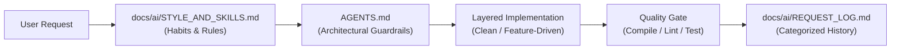

<div align="center">

# ⚡ Multi-Stack AI-Ready Starter Templates
### Next.js &bull; NestJS &bull; Flutter

**A production-grade, rules-first template repository designed to bootstrap architecture guidelines, centralized localization, engineering workflows, CI quality gates, and AI pair programming memory.**

[](./LICENSE)
[](./README.md)
[](templates/nextjs/)
[](templates/nestjs/)
[](templates/flutter/)
[](./AGENTS.md)
[](./core/docs/PROJECT_GUIDELINES.md)

<p align="center">
  <a href="#-quickstart-1-minute-setup">Quickstart</a> &bull;
  <a href="#-stack-overview--architecture-matrix">Architecture Matrix</a> &bull;
  <a href="#-why-this-template">Why This Template</a> &bull;
  <a href="#-scaffolding-guides">Scaffolding Guides</a> &bull;
  <a href="#-working-with-ai-agents">AI Guardrails</a> &bull;
  <a href="#-license">License</a>
</p>

---

</div>

## 💡 Why This Template?

Most starter kits ship bloated, decaying codebases with outdated libraries and stale boilerplate. This repository takes a **rules-first, zero-rot approach**:

| Feature | What You Get | Why It Matters |
|---|---|---|
| 🛡️ **Zero Boilerplate Rot** | Only architecture standards, documentation, and quality gates. | Always scaffold using the official, bleeding-edge framework CLIs without dependency hell. |
| 🤖 **AI Agent Memory & Guardrails** | Built-in `AGENTS.md` and persistent memory in `docs/ai/`. | Tools like **Antigravity**, **Cursor**, **Claude Code**, and **Copilot** adhere to your personal coding style and prevent architectural drift. |
| 🌐 **Centralized Copy & Locales** | Standardized dictionaries (`locales/*.json` & `l10n/*.arb`). | Eliminate hardcoded UI strings, error codes, and validation messages across web, API, and mobile from day one. |
| ⚡ **1-Command Setup CLI** | Remote `curl` execution or local interactive generator. | Bootstrap any existing Flutter, Next.js, or NestJS project with all dependencies installed in seconds. |
| ⏱️ **10-Minute Blocker Protocol** | Standardized offline blocker log (`docs/ISSUES.md`). | Halts runaway AI loops and keeps human teams unblocked and moving forward. |
| 🎯 **Enforced Layering** | Strict architectural separation for each stack. | Clean Architecture for Flutter (`presentation -> domain <- data`), Feature-first for Next.js, Module-first for NestJS. |

---

## 🚀 Quickstart (1-Minute Setup)

### Option A: 1-Liner Inside an Existing App (Recommended)

First create your app using the official framework CLI, navigate into the directory, and run the setup script:

```bash
# 1. Create your application (example: Flutter)
flutter create myapp
cd myapp

# 2. Run the remote setup CLI
bash <(curl -fsSL https://raw.githubusercontent.com/dinethsiriwardana/ai-agent-instructions-template/main/scripts/init-template.sh)
```

> [!TIP]
> **Works identically for any stack!**
> ```bash
> # Next.js
> pnpm create next-app myapp && cd myapp
> bash <(curl -fsSL https://raw.githubusercontent.com/dinethsiriwardana/ai-agent-instructions-template/main/scripts/init-template.sh)
>
> # NestJS
> npx @nestjs/cli new myapp && cd myapp
> bash <(curl -fsSL https://raw.githubusercontent.com/dinethsiriwardana/ai-agent-instructions-template/main/scripts/init-template.sh)
> ```

---

### Option B: Interactive CLI From Local Clone

Clone the repository and run the setup wizard with interactive prompts:

```bash
git clone https://github.com/dinethsiriwardana/ai-agent-instructions-template.git
cd ai-agent-instructions-template
bash scripts/init-template.sh
```

---

### Option C: Headless / Scripted Automation

Pass configuration directly via CLI flags for non-interactive setups, Docker containers, or CI jobs:

```bash
bash scripts/init-template.sh \
  --stack <nextjs|nestjs|flutter> \
  --target <target-directory> \
  --name "Product Name" \
  --description "One-sentence pitch" \
  --owner "Owner Name" \
  [--install | --no-install]
```

<details>
<summary><strong>🔍 Click to see what the Setup CLI does under the hood</strong></summary>

1. **Remote or Local Resolution**: Automatically downloads the template repo via shallow git clone (or tarball fallback) when executed via `curl`, or uses the local checkout.
2. **Auto-Detects Stack & Project Name**: Inspects `pubspec.yaml` (`flutter`) or `package.json` (`nextjs` / `nestjs`) in the target directory.
3. **Copies Shared Core & Chosen Stack**: Merges `core/` (`PROJECT_GUIDELINES.md`, `ISSUES.md`, `docs/ai/*`, PR template) and `templates/<stack>/` (`AGENTS.md`, `docs/*`, `locales/` or `l10n/`, `README.md`). Existing framework `README.md` files are safely backed up to `README.framework.md`.
4. **Replaces Placeholders**: Injects `{{PROJECT_NAME}}`, `{{ONE_LINE_DESCRIPTION}}`, `{{OWNER_NAME}}`, `{{STACK_LABEL}}`, `{{QUALITY_GATE}}`, and `YYYY-MM-DD` timestamps.
5. **Installs Stack Packages & Configures Tooling**: Runs `setup_stack` from `templates/<stack>/stack.conf` to install all required runtime/dev dependencies, inject scripts into `package.json`, set up localization flags, and scaffold Clean Architecture folders.
</details>

---

## 🏗️ Stack Overview & Architecture Matrix

| Concern | 🌐 Next.js (`templates/nextjs`) | ⚙️ NestJS (`templates/nestjs`) | 📱 Flutter (`templates/flutter`) |
|---|---|---|---|
| **Primary Focus** | Full-Stack Web Application | Modular REST API Backend | Cross-Platform Mobile Client |
| **Architecture** | Feature-first, layered | Module-per-feature, layered | Clean Architecture, feature-first |
| **Layering** | `UI -> hooks -> route -> service -> repo -> DB` | `Controller -> Service -> Repository -> DB` | `presentation -> domain <- data` |
| **Language / Runtime** | TypeScript `strict` / Node LTS | TypeScript `strict` / Node LTS | Dart 3 (sound null safety) / Flutter Stable |
| **State / Async** | TanStack Query + Server Components | Stateless services, Redis caching | BLoC (`flutter_bloc`), `bloc_concurrency` |
| **Validation / DTOs** | Zod (single source of truth for types) | Zod (`nestjs-zod`) + OpenAPI / Swagger | `freezed` + `json_serializable` (immutable) |
| **Data Access** | Drizzle ORM on PostgreSQL | Drizzle ORM on PostgreSQL | Dio HTTP client + `flutter_secure_storage` |
| **Styling & UI** | Tailwind CSS 4 with owned theme tokens | Structured JSON envelopes (`docs/API_RULES.md`) | Theme tokens, Material 3, shared widgets |
| **Centralized Locales** | `locales/en.json` (and `es.json`) | `locales/en.json` (and `es.json`) | `lib/l10n/app_en.arb` via `l10n.yaml` |
| **Testing Suite** | Vitest (unit), Playwright (E2E) | Jest + `@nestjs/testing` (unit), Supertest (E2E) | `flutter_test`, `bloc_test`, `mocktail` |
| **Quality Gate** | `typecheck && lint && test && build` | `typecheck && lint && test && test:e2e && build` | `format && analyze && test && build apk` |

---

## 📂 Repository Layout

```text
.
├── LICENSE                             # MIT Open Source License
├── AGENTS.md                           # Strict guidelines for AI agents maintaining this template
├── README.md                           # This guide & documentation hub
├── AI Agent History.md                 # Reverse-chronological log of all modifications & fixes
│
├── core/                               # Injected into EVERY generated project
│   ├── BRANCHES.md                     # Central branch registry (Active, In Review, Merged)
│   ├── scripts/
│   │   ├── git-flow.mjs                # Branch automation CLI (start, sync, pr, finish, list)
│   │   └── git-flow-lib.mjs            # Pure helper library for BRANCHES.md & PR URLs
│   ├── docs/
│   │   ├── PROJECT_GUIDELINES.md       # 3-stage branching (dev-test -> dev -> main), env scoping, safe DB migrations
│   │   ├── SUPABASE_RULES.md           # Full-spectrum Supabase rules (Schema, RLS, Auth/SSR, Storage, Edge Functions, Realtime, CLI)
│   │   ├── ISSUES.md                   # Parked blocker tracker for deep technical roadblocks
│   │   └── ai/                         # Continuous AI learning & personal profile system
│   │       ├── STYLE_AND_SKILLS.md     # Developer habits, skills, preferences & learned corrections
│   │       └── REQUEST_LOG.md          # User requests grouped by category (Feature, Bugfix, etc.)
│   └── .github/
│       └── pull_request_template.md    # Shared PR checklist with {{QUALITY_GATE}} placeholder
│
├── templates/                          # Stack-specific starter kits
│   ├── nextjs/                         # Next.js App Router rules and templates
│   │   ├── AGENTS.md                   # Strict coding and layering guidelines for Next.js
│   │   ├── docs/                       # PROJECT_PLAN, TASK_LIST, DECISIONS, UI_RULES
│   │   ├── locales/                    # Centralized UI copy & error dictionary (en.json, es.json)
│   │   ├── README.md                   # First steps and scaffolding guide for Next.js
│   │   └── stack.conf                  # Next.js metadata and quality gate definitions
│   │
│   ├── nestjs/                         # NestJS REST API rules and templates
│   │   ├── AGENTS.md                   # Strict module and layering guidelines for NestJS
│   │   ├── docs/                       # PROJECT_PLAN, TASK_LIST, DECISIONS, API_RULES
│   │   ├── locales/                    # Centralized API error codes & response copy (en.json, es.json)
│   │   ├── README.md                   # First steps and scaffolding guide for NestJS
│   │   └── stack.conf                  # NestJS metadata and quality gate definitions
│   │
│   └── flutter/                        # Flutter mobile rules, templates, and Clean Architecture
│       ├── AGENTS.md                   # Strict Clean Architecture guidelines for Flutter
│       ├── docs/                       # PROJECT_PLAN, TASK_LIST, DECISIONS, UI_RULES
│       ├── l10n.yaml                   # Flutter localization config
│       ├── lib/l10n/                   # ARB resource bundles for UI words & error failures
│       ├── README.md                   # First steps and scaffolding guide for Flutter
│       └── stack.conf                  # Flutter metadata and quality gate definitions
│
└── scripts/
    └── init-template.sh                # Multi-stack project generator & dependency installer
```

---

## 🛠️ Scaffolding Guides

If you prefer setting up manually without the automatic package installer:

### A. Next.js (Full-Stack Web)
```bash
# 1. Scaffold into the target directory
pnpm create next-app@latest . --ts --tailwind --app --src-dir --import-alias "@/*" --use-pnpm

# 2. Install core runtime & dev dependencies
pnpm add zod drizzle-orm @tanstack/react-query react-hook-form @hookform/resolvers server-only postgres
pnpm add -D drizzle-kit vitest @vitejs/plugin-react playwright @playwright/test prettier

# 3. Verify quality gate locally
pnpm typecheck && pnpm lint && pnpm test && pnpm build
```

---

### B. NestJS (REST API Backend)
```bash
# 1. Scaffold into the target directory
npx @nestjs/cli new . --package-manager pnpm --strict --skip-git

# 2. Install core runtime & dev dependencies
pnpm add zod nestjs-zod drizzle-orm @nestjs/config @nestjs/swagger @nestjs/throttler @nestjs/terminus nestjs-pino pino-http helmet postgres
pnpm add -D drizzle-kit pino-pretty supertest @types/supertest

# 3. Verify quality gate locally
pnpm typecheck && pnpm lint && pnpm test && pnpm test:e2e && pnpm build
```

---

### C. Flutter (Cross-Platform Mobile)
```bash
# 1. Scaffold into the target directory
flutter create . --org com.yourdomain --project-name your_app_name

# 2. Install core runtime & dev dependencies
flutter pub add flutter_bloc bloc_concurrency go_router dio get_it freezed_annotation json_annotation equatable flutter_secure_storage intl
flutter pub add --dev build_runner freezed json_serializable bloc_test mocktail flutter_lints

# 3. Verify quality gate locally
dart format --set-exit-if-changed . && flutter analyze && flutter test --coverage && flutter build apk --debug
```

---

## 🤖 Working with AI Agents

Every bootstrapped project includes a top-level **`AGENTS.md`** file and a **`docs/ai/`** memory folder designed for **Antigravity**, **Cursor**, **Claude Code**, **GitHub Copilot**, and **Windsurf**:



1. **Mandatory First Read**: Instruct your AI agent to read `docs/ai/STYLE_AND_SKILLS.md` and `AGENTS.md` before generating or modifying any code.
2. **Adaptive Learning**: Whenever you correct your AI (*"Prefer early returns"*, *"Use Drizzle transaction"*, *"Never use raw strings"*), the agent logs it into Section 4 of `docs/ai/STYLE_AND_SKILLS.md` so it never repeats the mistake.
3. **Categorized Memory**: Every completed prompt is logged in `docs/ai/REQUEST_LOG.md` under Feature, Bugfix, Refactoring, Architecture, or DevOps.
4. **Enforced Boundaries**: Prevents common AI anti-patterns:
   - Next.js: No database queries in client components.
   - NestJS: No raw SQL in controllers.
   - Flutter: No HTTP calls or business logic inside widgets.
5. **The 10-Minute Blocker Protocol**: If an agent gets blocked on an issue for >10 minutes, it stops spinning and parks the issue in `docs/ISSUES.md`.

---

## 🌐 Coordinated Multi-Stack Systems

Building a full product consisting of Web + Backend API + Mobile app? Organize them seamlessly into a monorepo or polyrepo:

```text
my-product/
├── apps/
│   ├── web/        <- Generated with --stack nextjs
│   ├── api/        <- Generated with --stack nestjs
│   └── mobile/     <- Generated with --stack flutter
```

- **Single Contract Source of Truth**: The NestJS project's `docs/API_RULES.md` and `@nestjs/swagger` OpenAPI output define all contracts.
- **Client Synchronization**: Web and mobile clients generate typed API clients directly from the OpenAPI spec, preventing drift.
- **Unified Engineering Workflows**: Identical branching model (`main` & `dev`), PR checklist templates, and Conventional Commits across the entire stack.

---

## ➕ How to Add a New Stack (e.g. Go, FastAPI, React Native)

Extending this template repository is simple and modular:

1. Create a new directory `templates/<stack_name>/`:
   - `AGENTS.md`: Architectural rules, folder structure, and coding guidelines.
   - `docs/`: Stack-specific planning, tasks, ADRs, and UI/API rules.
   - `locales/`: Centralized text/error dictionaries.
   - `README.md`: First steps and CLI scaffolding commands.
   - `stack.conf`: Define `STACK_LABEL`, `QUALITY_GATE`, and `setup_stack()`.
2. Add your stack name to the `STACKS` array in `scripts/init-template.sh`:
   ```bash
   STACKS=(nextjs nestjs flutter <new_stack>)
   ```
3. Test your generator in a temporary directory:
   ```bash
   T=$(mktemp -d)
   bash scripts/init-template.sh --stack <new_stack> --target "$T/test" --name "Test App" --description "Desc" --owner "Owner"
   rm -rf "$T"
   ```

---

## 🤝 Contributing

Contributions, issues, and feature requests are welcome!

1. Fork the repository.
2. Create your feature branch (`git checkout -b feat/amazing-feature`).
3. Commit your changes following [Conventional Commits](https://www.conventionalcommits.org/) (`git commit -m 'feat: add amazing feature'`).
4. Ensure all placeholder generator tests pass:
   ```bash
   T=$(mktemp -d)
   for s in nextjs nestjs flutter; do
     bash scripts/init-template.sh --stack $s --target "$T/$s" --name "App" --description "Desc" --owner "Owner"
     grep -RE "\{\{(PROJECT_NAME|ONE_LINE_DESCRIPTION|OWNER_NAME|STACK_LABEL|QUALITY_GATE)\}\}" "$T/$s" && echo "Error: unhandled placeholder in $s"
   done
   rm -rf "$T"
   ```
5. Push to the branch and open a Pull Request.

---

## 📄 License

This project is open-source software licensed under the **[MIT License](./LICENSE)**. You are free to use, modify, and distribute it in personal or commercial projects.

---

## 📜 Version History

**TEMPLATE_VERSION: 2.7.0**

| Version | Description |
|---|---|
| **2.7.0** | Added comprehensive Supabase rules (`core/docs/SUPABASE_RULES.md`) covering Database Schema, High-Performance RLS (`(select auth.uid())`, `security_invoker` views, `SECURITY DEFINER` helpers), Auth (`@supabase/ssr`, JWKS, `app_metadata` RBAC), Storage buckets & policies, Edge Functions, Realtime Broadcast, Local CLI & pgTAP testing, plus stack-specific Supabase integration rules in Next.js, NestJS, and Flutter `AGENTS.md`. |
| **2.6.0** | Added 3-stage branching strategy (`dev-test` local -> `dev` QA -> `main` Prod), `core/BRANCHES.md` central branch registry, `core/scripts/git-flow.mjs` CLI automation (`branch:start`, `branch:sync`, `branch:pr`, `branch:finish`, `branch:list`), environment variable scoping (`Production Only` vs `Preview / Development Only` with `Dev_*` fallback), and versioned data-safe DB migration rules (merge-only prod migrations). |
| **2.5.0** | Polished repository presentation: added MIT License (`LICENSE`), hero banner, modern shields badges, architectural comparison matrix, and quick navigation. |
| **2.4.0** | Enhanced `scripts/init-template.sh` and `templates/<stack>/stack.conf` to support remote GitHub one-liner execution (`curl`), existing-project stack auto-detection (`flutter create myapp && cd myapp`), and automatic package/dependency installation (`setup_stack`). |
| **2.3.0** | Added centralized language, copy, and error message dictionaries (`locales/` and `lib/l10n/`) across Next.js, NestJS, and Flutter. |
| **2.2.0** | Added `docs/ai/` memory system (`STYLE_AND_SKILLS.md` and `REQUEST_LOG.md`) for continuous AI learning, adaptive code styling, and categorized prompt tracking. |
| **2.1.0** | Comprehensive root documentation, template repo `AGENTS.md`, and clean root directory structure. |
| **2.0.0** | Multi-stack architecture: shared `core/`, stack folders for Next.js, NestJS, Flutter, and stack-aware CLI generator. |
| **1.0.0** | Initial generic Next.js template: unified stack (Zod, Drizzle, TanStack Query), ADR log, and CI workflow. |

---

<div align="center">

**Crafted with care by [Dineth Siriwardana](https://github.com/dinethsiriwardana) &bull; ⭐ Star this repo if you find it helpful!**

</div>
