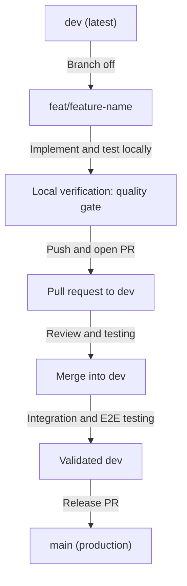

# Project Guidelines and Development Workflow

Mandatory workflow, branching strategy, quality gates and maintenance routine for **{{PROJECT_NAME}}** ({{STACK_LABEL}}).

This file is shared by every stack in the template. Stack-specific commands come from the quality gate below.

---

## Quality gate

Every change must pass this before a pull request is opened, and CI runs the same commands:

```bash
{{QUALITY_GATE}}
```

---

## 1. Branching Strategy

| Branch | Role | Rules |
|---|---|---|
| `main` | Production / stable releases | Always deployable. Direct commits and unreviewed pushes are forbidden. Merges come only from `dev` (or `hotfix/*`) after testing. |
| `dev` | Active development and integration | Primary integration branch. All feature branches start from and target `dev`. |
| `feat/*` | New features | One per feature or enhancement. Branched off `dev`. |
| `fix/*` | Bug fixes | One per defect. Branched off `dev`. |
| `chore/*` / `refactor/*` | Maintenance | Tooling, dependency bumps, internal refactors. Branched off `dev`. |
| `docs/*` | Documentation only | Branched off `dev`. |
| `hotfix/*` | Urgent production fix | Branched off `main`, merged into `main` and then back into `dev`. Use only for production incidents. |

Naming: kebab-case, descriptive, for example `feat/task-timer`, `fix/deadline-calculation`, `chore/bump-dependencies`.

---

## 2. Feature Development Workflow



### Step 0: Definition of ready

Before starting, the task must have: a line in `docs/TASK_LIST.md`, a clear acceptance criterion, and (if it changes architecture) an entry planned in `docs/DECISIONS.md`.

### Step 1: Branch off `dev`

```bash
git checkout dev
git pull origin dev
git checkout -b feat/<feature-name>
```

### Step 2: Implement within the rules

- Follow `AGENTS.md` (layers, folder structure, size limits, tests).
- Follow the UI or API rules document of the stack (`docs/UI_RULES.md` or `docs/API_RULES.md`).
- Centralized copy & error text: never hardcode user-facing strings or error messages; always use the stack's centralized dictionary (`locales/` or `lib/l10n/`) so text and languages can be updated from one place.
- No emojis in UI text, comments or commit messages.
- Commit small and often using Conventional Commits (section 3).

### Step 3: Local verification and the 10-minute blocker rule

Run the quality gate (top of this file).

> **The 10-minute blocker rule.** If any error, build issue or bug cannot be resolved within 10 minutes:
> 1. **Stop** debugging immediately.
> 2. **Record it**: open a GitHub issue with context, error logs, environment and reproduction steps, or add an entry to `docs/ISSUES.md` if working offline.
> 3. **Continue** with the next task, or isolate the problem in a separate branch so progress is not blocked.

### Step 4: Open a pull request to `dev`

```bash
git push -u origin feat/<feature-name>
```

- Target `dev`, never `main` (except `hotfix/*`).
- Fill in the PR template: what changed, how to test, verification checklist.

### Step 5: Review, test and merge into `dev`

- The PR needs code review and manual testing against its acceptance criteria.
- Merge only when checks are green and review comments are resolved.
- **Do not delete feature or fix branches after merging.** Keep all branches in the repository.

### Step 6: Integration testing and release to `main`

- Run regression and staging checks on `dev`.
- Open a release PR from `dev` into `main`; merge after final checks.
- Tag the release (`vMAJOR.MINOR.PATCH`) and update the changelog (section 6).

---

## 3. Commit Message Standards

Follow [Conventional Commits](https://www.conventionalcommits.org/):

- `feat: add task timer start and stop controls`
- `fix: resolve remaining hours calculation on recurring tasks`
- `refactor: extract scheduling rules into a dedicated service`
- `style: update dashboard cards to match design tokens`
- `test: add regression test for overdue detection`
- `chore: update dependencies and tooling config`
- `docs: update project roadmap and testing instructions`

Rules: imperative mood, lowercase type, no trailing period, under 72 characters in the subject, no emojis. Breaking changes use `feat!:` or a `BREAKING CHANGE:` footer.

---

## 4. Code Review Checklist

Reviewers confirm each item before approving:

- [ ] Layer and import-boundary rules respected (`AGENTS.md`)
- [ ] No duplicated logic that a shared piece already covers
- [ ] Inputs validated; auth and ownership checks present (security checklist in `AGENTS.md`)
- [ ] Tests added or updated and meaningful (happy path, failure, edge case)
- [ ] UI or API rules followed (`docs/UI_RULES.md` or `docs/API_RULES.md`)
- [ ] Loading, empty and error states present (UI changes)
- [ ] No file or function over the size limits
- [ ] No secrets, debug print leftovers or commented-out code
- [ ] Migrations are reversible or safe, and the env example file is updated
- [ ] `docs/TASK_LIST.md` updated; decisions logged in `docs/DECISIONS.md`

---

## 5. Environments and Secrets

| Environment | Branch | Purpose |
|---|---|---|
| Local | any | Development with a local or dev backend |
| Preview | PR branches | Automatic preview deployments or test builds for review |
| Staging | `dev` | Integration and regression testing |
| Production | `main` | Live users |

- Secrets live only in the hosting provider's or CI secret store and local untracked env files (never committed).
- The env example file documents every variable with a safe placeholder value.
- Each environment has its own database and backend. Never point a local or preview build at production data.
- Rotate any secret that is exposed in logs, screenshots or commits immediately.

---

## 6. Releases, Versioning and Changelog

- Semantic versioning: `MAJOR.MINOR.PATCH`.
- Maintain `CHANGELOG.md` using the Keep a Changelog format (Added, Changed, Fixed, Removed, Security).
- Release checklist:
  1. `dev` is green on CI and manually regression-tested.
  2. Database migrations reviewed and applied to staging first (backend stacks).
  3. Release PR `dev` -> `main` approved.
  4. Tag created, changelog updated, deployment or store build verified, smoke test run.
  5. Rollback plan confirmed (previous deployment or build, and database backup point).

---

## 7. Documentation Upkeep

| Change | Update |
|---|---|
| Feature completed | Tick it in `docs/TASK_LIST.md` |
| Scope change or new requirement | `docs/PROJECT_PLAN.md` (and its change log) |
| Technical or architectural choice | New entry in `docs/DECISIONS.md` |
| New UI component or token (UI stacks) | Spec in `docs/UI_RULES.md` |
| New endpoint convention (API stack) | `docs/API_RULES.md` |
| New environment variable | The env example file and the env validation module |
| Parked blocker | `docs/ISSUES.md` or a GitHub issue |
| User request completed (AI session) | Grouped entry in `docs/ai/REQUEST_LOG.md` |
| Developer preference / style correction | Update `docs/ai/STYLE_AND_SKILLS.md` |
| New or changed rule | `AGENTS.md` (explain in the PR why) |

Documentation changes ship in the same PR as the code that caused them.

---

## 8. Maintenance Routine

| Cadence | Activity |
|---|---|
| Every PR | Full verification (quality gate); docs upkeep |
| Weekly | Review open items in `docs/ISSUES.md`; triage new GitHub issues; check CI health |
| Monthly | Dependency updates on a `chore/*` branch (patch and minor first); run the dependency audit; review error logs and performance |
| Quarterly | Major dependency and framework upgrades; review backups by performing a test restore; review `AGENTS.md` for drift; prune unused code and feature flags |
| Per release | Changelog, tag, smoke test, rollback plan check |

Upgrade protocol for framework or major library bumps: dedicated `chore/*` branch, read the official migration guide, run all checks, test critical flows manually, record the decision in `docs/DECISIONS.md`.

---

## 9. Golden Rules

1. Never commit directly to `main` or `dev`.
2. Every feature branch starts from `dev` and merges back into `dev` through a pull request.
3. Merge `dev` into `main` only after thorough review and testing.
4. Never delete branches after merging. Keep all branches preserved.
5. Always run the quality gate before pushing.
6. Always follow the UI or API rules document for the stack.
7. 10-minute blocker protocol: if an error cannot be fixed in 10 minutes, record it and move on.
8. Docs ship with the code: update the task list, decisions and plan in the same PR.
9. Continuous AI Learning: Categorize requests in `docs/ai/REQUEST_LOG.md` and log style preferences in `docs/ai/STYLE_AND_SKILLS.md`.
