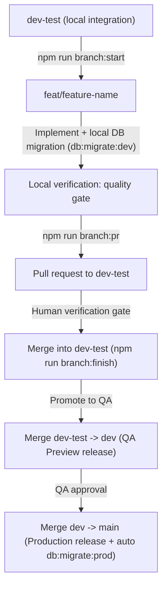

# Project Guidelines and Development Workflow

Mandatory workflow, branching strategy, environment isolation, database migration safety, quality gates and maintenance routine for **{{PROJECT_NAME}}** ({{STACK_LABEL}}).

This file is shared by every stack in the template. Stack-specific commands come from the quality gate below.

---

## Quality gate

Every change must pass this before a pull request is opened, and CI runs the same commands:

```bash
{{QUALITY_GATE}}
```

---

## 1. Branching Strategy & `BRANCHES.md` Registry

> **MANDATORY**: Direct work or commits on `main` or `dev` are strictly forbidden. All feature, fix, chore, and refactor branches originate from and target `dev-test`. Always maintain branch status in `BRANCHES.md` using the branch automation commands (`npm run branch:*` / `pnpm branch:*`).

| Branch | Role | Rules |
|---|---|---|
| `main` | Production / stable releases | Always deployable. Direct commits and unreviewed pushes are forbidden. Merges come only from `dev` (or `hotfix/*`) after QA validation. |
| `dev` | QA / Staging releases | Deployed to Preview / Staging for QA validation. Merges come only from `dev-test` after local integration testing. |
| `dev-test` | Active development and local integration | Primary integration branch tested locally. **All** `feat/*`, `fix/*`, `chore/*`, `refactor/*`, and `docs/*` branches start from and target `dev-test`. |
| `feat/*` | New features | One per feature or enhancement. Branched off `dev-test`. Targets `dev-test`. |
| `fix/*` | Bug fixes | One per defect. Branched off `dev-test`. Targets `dev-test`. |
| `chore/*` / `refactor/*` | Maintenance & tooling | Tooling, dependency bumps, internal refactors. Branched off `dev-test`. Targets `dev-test`. |
| `docs/*` | Documentation only | Branched off `dev-test`. Targets `dev-test`. |
| `hotfix/*` | Urgent production fix | Branched off `main`, merged into `main` and then back into `dev` and `dev-test`. Use only for production incidents. |

Naming: kebab-case, descriptive, for example `feat/task-timer`, `fix/deadline-calculation`, `chore/bump-dependencies`.

### Branch Automation Commands

```bash
# 1. Start or resume a branch (syncs origin/dev-test & registers in BRANCHES.md as Active):
npm run branch:start -- feat/your-feature-name "Short description of the feature"

# 2. Sync latest origin/dev-test into your current working branch:
npm run branch:sync

# 3. Run quality gate, push branch, and open PR targeting dev-test (updates BRANCHES.md to In Review):
npm run branch:pr -- "feat: your PR title"

# 4. After user testing & approval, switch back to dev-test and mark Merged in BRANCHES.md:
npm run branch:finish

# 5. View all tracked branches in BRANCHES.md:
npm run branch:list
```

---

## 2. Three-Stage Feature Development Workflow (`dev-test` -> `dev` -> `main`)



### Step 0: Check `BRANCHES.md` & Definition of Ready

Before starting:
1. Check `BRANCHES.md` and remote branches for an existing branch covering the task.
2. Confirm the task has a line in `docs/TASK_LIST.md`, a clear acceptance criterion, and (if it changes architecture) an entry planned in `docs/DECISIONS.md`.

### Step 1: Start or Resume Branch off `dev-test`

```bash
npm run branch:start -- feat/<feature-name> "Short description"
```

### Step 2: Implement within the rules

- Follow `AGENTS.md` (layers, folder structure, size limits, tests).
- Follow the UI or API rules document of the stack (`docs/UI_RULES.md` or `docs/API_RULES.md`).
- Centralized copy & error text: never hardcode user-facing strings or error messages; always use the stack's centralized dictionary (`locales/` or `lib/l10n/`) or bilingual components so text and languages can be updated from one place.
- No emojis in UI text, comments or commit messages.
- Commit small and often using Conventional Commits (section 3).

### Step 3: Local verification and the 10-minute blocker rule

Run the quality gate (top of this file).

> **The 10-minute blocker rule.** If any error, build issue or bug cannot be resolved within 10 minutes:
> 1. **Stop** debugging immediately.
> 2. **Record it**: open a GitHub issue with context, error logs, environment and reproduction steps, or add an entry to `docs/ISSUES.md` if working offline.
> 3. **Continue** with the next task, or isolate the problem in a separate branch so progress is not blocked.

### Step 4: Open a pull request to `dev-test`

```bash
npm run branch:pr -- "feat: concise summary"
```

- Always target `dev-test`, never `main` or `dev` directly (except `hotfix/*`).
- Fill in the PR template: what changed, how to test, verification checklist.
- `BRANCHES.md` status updates to `In Review`.

### Step 5: Human Verification Gate & Merge into `dev-test`

- Share the PR link and verification results with the user/reviewer.
- **Never auto-merge without explicit confirmation after testing.**
- Once approved, merge into `dev-test` and run `npm run branch:finish` to update `BRANCHES.md` to `Merged` and return to `dev-test`.

### Step 6: QA Release (`dev`) and Production Release (`main`)

1. **QA Release (`dev-test` -> `dev`)**:
   - Merge verified `dev-test` into `dev`.
   - Deploys to Preview / Staging for QA using the Dev database (`Preview / Development` scope) and automatically runs `db:migrate:dev`.
2. **Production Release (`dev` -> `main`)**:
   - After QA sign-off on `dev`, open and merge the release PR from `dev` into `main`.
   - Merging to `main` automatically runs the production database migration (`db:migrate:prod`), deploys Production, tags the release (`vMAJOR.MINOR.PATCH`), and updates `CHANGELOG.md`.

---

## 3. Commit Message Standards

Follow [Conventional Commits](https://www.conventionalcommits.org/):

- `feat: add task timer start and stop controls`
- `fix: resolve remaining hours calculation on recurring tasks`
- `refactor: extract scheduling rules into a dedicated service`
- `style: update dashboard cards to match design tokens`
- `test: add regression test for overdue detection`
- `chore: update dependencies and tooling config`
- `docs: update project roadmap and testing instructions`

Rules: imperative mood, lowercase type, no trailing period, under 72 characters in the subject, no emojis. Breaking changes use `feat!:` or a `BREAKING CHANGE:` footer.

---

## 4. Code Review Checklist

Reviewers confirm each item before approving:

- [ ] Layer and import-boundary rules respected (`AGENTS.md`)
- [ ] No duplicated logic that a shared piece already covers
- [ ] Inputs validated; auth and ownership checks present (security checklist in `AGENTS.md`)
- [ ] Tests added or updated and meaningful (happy path, failure, edge case)
- [ ] UI or API rules followed (`docs/UI_RULES.md` or `docs/API_RULES.md`)
- [ ] Loading, empty and error states present (UI changes)
- [ ] No file or function over the size limits
- [ ] No secrets, debug print leftovers or commented-out code
- [ ] Migrations are additive/non-destructive (`IF NOT EXISTS`), and `.env.example` is updated
- [ ] `BRANCHES.md` and `docs/TASK_LIST.md` updated; decisions logged in `docs/DECISIONS.md`

---

## 5. Environments, Scoped Variables & Data-Safe DB Migrations

### 5.1 Three-Stage Environment Matrix

| Stage | Environment | Branch | Database & Env Scope | Migration Execution |
|---|---|---|---|---|
| **Stage 1: Local** | `development` | `dev-test`, `feat/*`, `fix/*` | Dev DB via `.env.development` / `.env.local` | Run locally anytime (`npm run db:migrate:dev`) |
| **Stage 2: QA** | `preview` | `dev` | Dev DB via Preview-scoped `DATABASE_URL` (or `Dev_*` fallback) | Auto-runs on merge/push to `dev` (`db:migrate:dev`) |
| **Stage 3: Prod** | `production` | `main` | Prod DB via Production-scoped `DATABASE_URL` | **Merge-only**: Auto-runs ONLY on merge to `main` (`db:migrate:prod`). Blocked locally. |

### 5.2 Environment Variable Scoping Rules

1. **Use Identical Standard Variable Names Across Environments**:
   - Database variables (`DATABASE_URL`, `DATABASE_URL_UNPOOLED`, `POSTGRES_URL`, etc.) use the **same standard names** in every environment, separated by hosting target scope:
     - **`Production` Only** -> Production Database.
     - **`Preview & Development` Only** -> Dev / QA Database.
   - `src/config/env.ts` also supports `Dev_*` (`Dev_DATABASE_URL`, `Dev_POSTGRES_URL`) as a priority fallback in non-production (`VERCEL_ENV !== "production"`) so storage integrations that prefix second databases work with zero manual renaming.
   - Common third-party API keys (e.g., Auth, Email, CRM, Billing) are scoped to **`Production, Preview, and Development`**.
2. **Local Development Safety (`.env.development`)**:
   - Local development (`next dev` / local server) must load `.env.development` / `.env.local` pointing strictly to the **Dev Database**, never the Production Database.

### 5.3 Data-Safe Database Migration Protocol

1. **Versioned & Checksum-Verified (`__schema_migrations`)**:
   - Every SQL migration in `src/server/db/migrations/` is tracked in a `__schema_migrations` table with its filename, SHA-256 checksum, execution time, and timestamp so each migration runs exactly once.
2. **Zero Data Loss Guard (Additive Only)**:
   - Migrations must use idempotent, non-destructive statements (`CREATE TABLE IF NOT EXISTS`, `ALTER TABLE ... ADD COLUMN IF NOT EXISTS`, `CREATE INDEX IF NOT EXISTS`).
   - The migration runner scans SQL before execution and **automatically blocks** destructive statements (`DROP TABLE`, `DROP COLUMN`, `TRUNCATE`, `DROP SCHEMA`) unless explicitly annotated with `-- @allow-destructive`.
3. **Strict Local Production Block**:
   - `npm run db:migrate:dev` can be run locally (`dev-test`) and in QA CI (`dev`).
   - `npm run db:migrate:prod` **refuses to run on a local machine**—it verifies `VERCEL_ENV === "production"` or `CI === "true"` on `refs/heads/main` before executing.

---

## 6. Releases, Versioning and Changelog

- Semantic versioning: `MAJOR.MINOR.PATCH` (or date-stamped release tags `vYYYY.MM.DD-N`).
- Maintain `CHANGELOG.md` using the Keep a Changelog format (Added, Changed, Fixed, Removed, Security).
- Release checklist:
  1. Feature branches verified and merged into `dev-test`.
  2. `dev-test` merged into `dev` for QA preview validation; `db:migrate:dev` verified on Dev DB.
  3. Release PR `dev` -> `main` approved and merged.
  4. Production build automatically runs `db:migrate:prod`, tags the release, updates `CHANGELOG.md`, and dispatches release notifications.

---

## 7. Documentation Upkeep

| Change | Update |
|---|---|
| Branch started / PR opened / merged | `BRANCHES.md` (via `branch:start`, `branch:pr`, `branch:finish`) |
| Feature completed | Tick it in `docs/TASK_LIST.md` |
| Scope change or new requirement | `docs/PROJECT_PLAN.md` (and its change log) |
| Technical or architectural choice | New entry in `docs/DECISIONS.md` |
| New UI component or token (UI stacks) | Spec in `docs/UI_RULES.md` |
| New endpoint convention (API stack) | `docs/API_RULES.md` |
| New environment variable | `.env.example` and `src/config/env.ts` |
| Parked blocker | `docs/ISSUES.md` or a GitHub issue |
| User request completed (AI session) | Grouped entry in `docs/ai/REQUEST_LOG.md` & `AI Agent History.md` |
| Developer preference / style correction | Update `docs/ai/STYLE_AND_SKILLS.md` |
| New or changed rule | `AGENTS.md` (explain in the PR why) |

Documentation changes ship in the same PR as the code that caused them.

---

## 8. Maintenance Routine

| Cadence | Activity |
|---|---|
| Every PR | Full verification (quality gate); `BRANCHES.md` & docs upkeep |
| Weekly | Review open items in `docs/ISSUES.md`; triage new GitHub issues; check CI health |
| Monthly | Dependency updates on a `chore/*` branch targeting `dev-test`; run dependency audit; review error logs and performance |
| Quarterly | Major dependency and framework upgrades; review backups by performing a test restore; review `AGENTS.md` for drift; prune unused code and feature flags |
| Per release | Changelog, tag, smoke test, rollback plan check |

---

## 9. Golden Rules

1. Never commit directly to `main` or `dev`.
2. Every `feat/*`, `fix/*`, `chore/*`, and `docs/*` branch starts from `dev-test` and merges back into `dev-test` through a pull request.
3. Track every branch lifecycle (`Active` -> `In Review` -> `Merged`) in `BRANCHES.md`.
4. Promote `dev-test` -> `dev` for QA testing, and merge `dev` -> `main` only after QA sign-off.
5. Never run production database migrations locally; `db:migrate:prod` runs automatically only when merging to `main`.
6. Always run the quality gate before pushing.
7. Always follow the UI or API rules document for the stack.
8. 10-minute blocker protocol: if an error cannot be fixed in 10 minutes, record it and move on.
9. Continuous AI Learning: Categorize requests in `docs/ai/REQUEST_LOG.md` and log style preferences in `docs/ai/STYLE_AND_SKILLS.md`.
